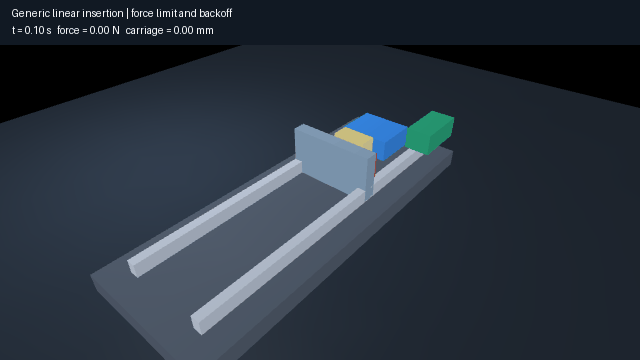
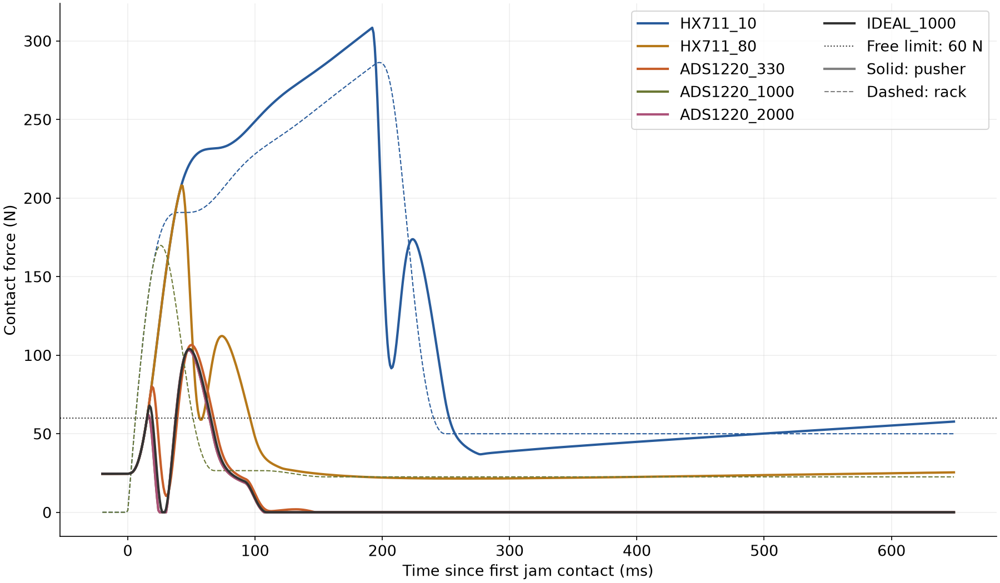

# Force-limited insertion





A simulated insertion axis that stops itself when it hits something. The C firmware runs against a simulated carriage, a Python host talks to it over a CAN bus, and the force sensor and brake circuits are checked in ngspice.

- A normal insertion seats in about 5 s.
- A jam trips at about 15 N, roughly 0.2 s after contact, and the carriage backs off about 2 mm.
- Latency was the annoying part. The force reading goes through the sensor, ADC, filter and CAN before the firmware sees it, so I compared sensor options and bus delays. With competing motion traffic on the bus, the force value stays under 1 ms old in the fastest case.
- I checked the sensor divider and filter against ngspice at 30 DC points, and ran the brake through 153 corner simulations.

Exact numbers are in `results/3d/summary.json`, `hw/summary.json` and [docs/RESULTS.md](docs/RESULTS.md).

## Run it

You need the packages in `requirements.txt` and an ngspice shared library. Set `NGSPICE_DLL` to its path, or use the default KiCad install described in [hw/README.md](hw/README.md). From the repo root:

```text
python build.py
python scripts/demo_insert.py
python -m hw.fsr.run
python hw/run_all.py
python -m experiments.run_all
python -m sim3d.cases results/3d
python -m sim3d.render results/3d media
python -m pytest -q -p no:cacheprovider
```

Model parameters are in [docs/ASSUMPTIONS.md](docs/ASSUMPTIONS.md).

[MIT license](LICENSE).
